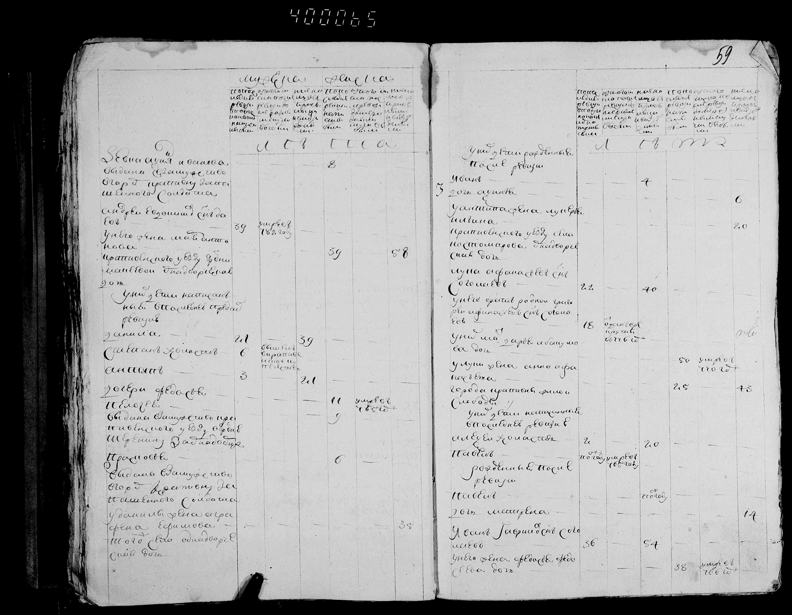
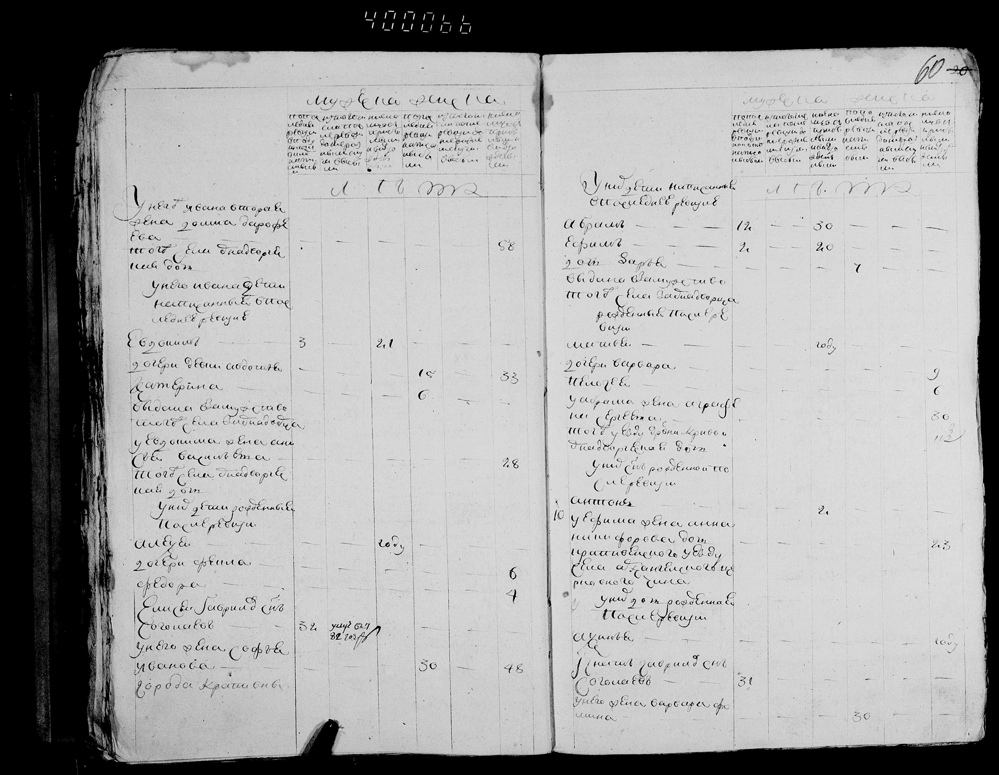

# Ревизская сказка 1782 года, село Левенское: семья Ивана Гаврилова

Образы 185 и 186 в DGS 7563659 на FamilySearch:
https://www.familysearch.org/search/film/007563659?i=184 — листы 58 об. – 59 и
59 об. – 60. 4-я ревизия, № 20, однодворцы села Левенского Одоевского уезда;
ГАТО (Тула), ф. 345, оп. 1, д. 6. Лета — по ревизии 1763 года и в 1782 году.
Расшифровка сделана с помощью ИИ (Claude) и сверена с образами.

| Запись | Муж. 1763 | Выбыл | Муж. 1782 | Жен. 1763 | Выбыла | Жен. 1782 |
|---|---|---|---|---|---|---|
| «Иван Гаврилов сын Согомаев(?)» (образ 185) | 36 | — | 54 | | | |
| «У него жена Федосья Федосеева дочь» | | | | 38 | «умре в 1766 году» | |
| «У него ж Ивана вторая жена Домна Дорофеева того ж села однодворческая дочь» (образ 186) | | | | | | 58 |
| «У него Ивана дети написанные в последней ревизии: Евдоким» | 3 | — | 21 | | | |
| «дочери девки Авдотья» | | | | 15 | — | 33 |
| «Катерина», «выдана в замужство того ж села за однодворца» | | | | 6 | | |
| «У Евдокима жена Анисья Васильева того ж села однодворческая дочь» | | | | | | 28 |
| «У них дети рожденные после ревизии: Алексей» | | | «году» | | | |
| «дочери Фекла» | | | | | | 6 |
| «Федора» | | | | | | 4 |

Фамилия читается неуверенно: «Согомаев(?)»; в сказке 1795 года — «Согалаев».
