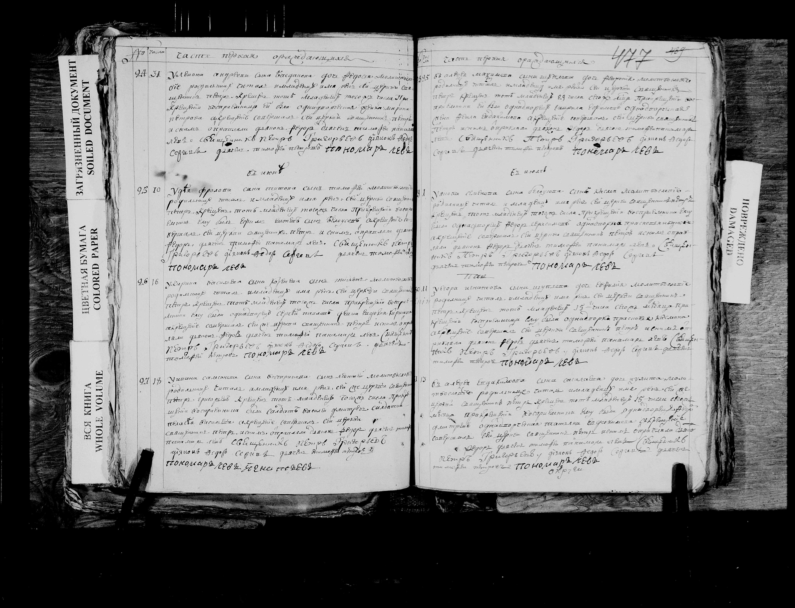
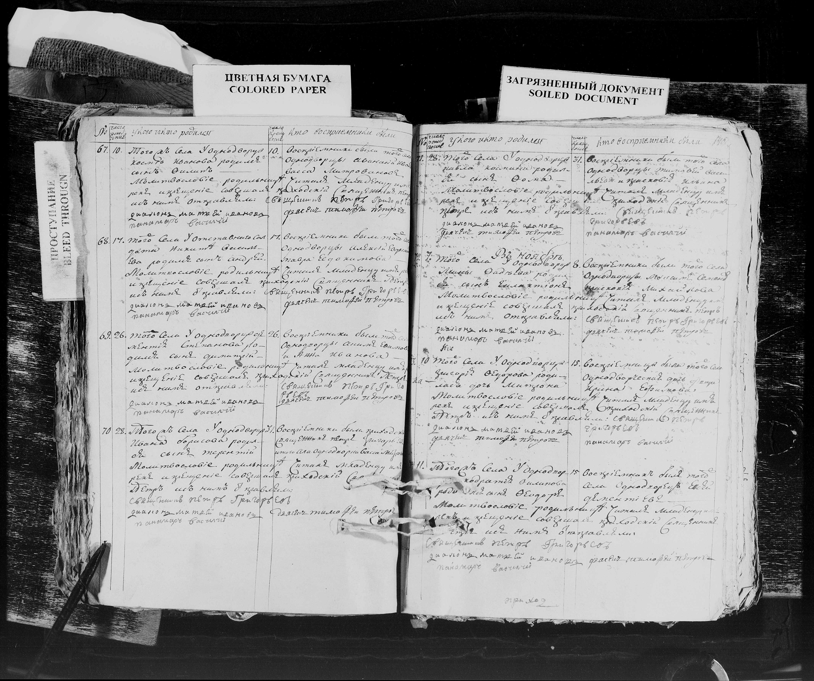
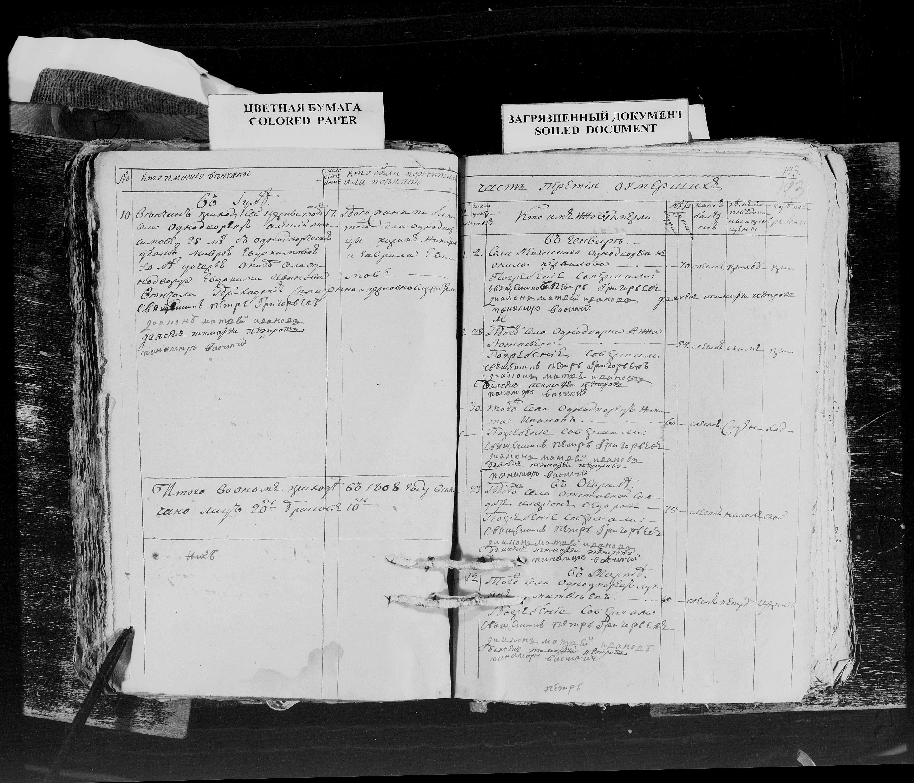

# Метрические книги Николаевской церкви села Левенского, 1806 и 1808 годы

Тетради в томах Тульской духовной консистории, ГАТО (Тула), ф. 3, оп. 15:
1806 год — д. 1061, образ 477 в DGS 7558432
(https://www.familysearch.org/search/film/007558432?i=476), листы 476 об. –
477; 1808 год — д. 1063, образы 227 и 233 в DGS 7558434
(https://www.familysearch.org/search/film/007558434?i=226). Расшифровка
сделана с помощью ИИ (Claude) и сверена с образами.

- 1806 год, родившиеся, № 31, 13 (июля?): «У Алексея Евдакимова сына
  Сагалаева дочь Иулита. Молитвословие родильнице читал и младенцу имя
  нарек сей же церкви священник Петр. Крещен тот младенец 15 числа сего ж
  месяца. При крещении восприемники ему были однадворец Федор Дмитреев
  однадворческая Татьяна Евдакимова а крещение совершал сей церкви
  священник Петр и с ним отправляли дьякон Федор, дьячек Тимофей, панамарь
  Лев.»
- 1808 год, родившиеся, № 68, 17 (образ 227): «Того села у Отставного
  солдата Никиты Васильева родился сын Андрей … Восприемники были того
  села однодворцы Алексей Евдоки[мов], Мавра Евдокимова».
- 1808 год, браки, № 10, 17 (образ 233): «Венчан приходу сей церкви того
  села однодворец Алексей Максимов 25 лет с однодворческою девкою Маврою
  Евдокимовою 20 лет дочерью того села однодворца Евдокима Иванова».
