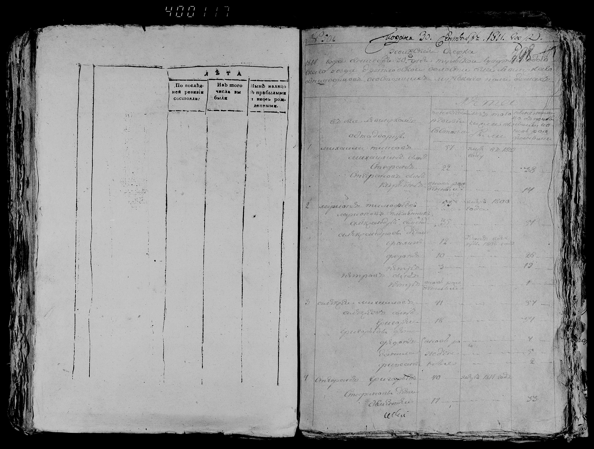
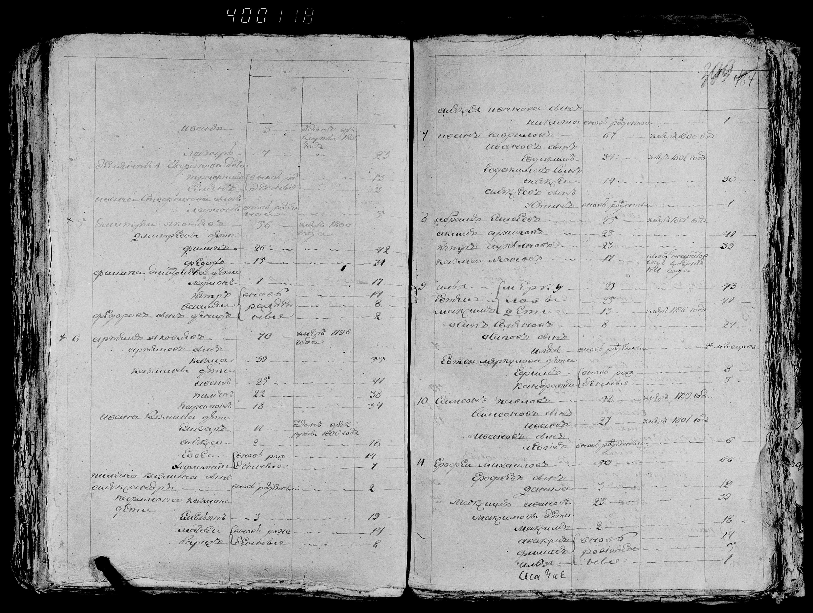
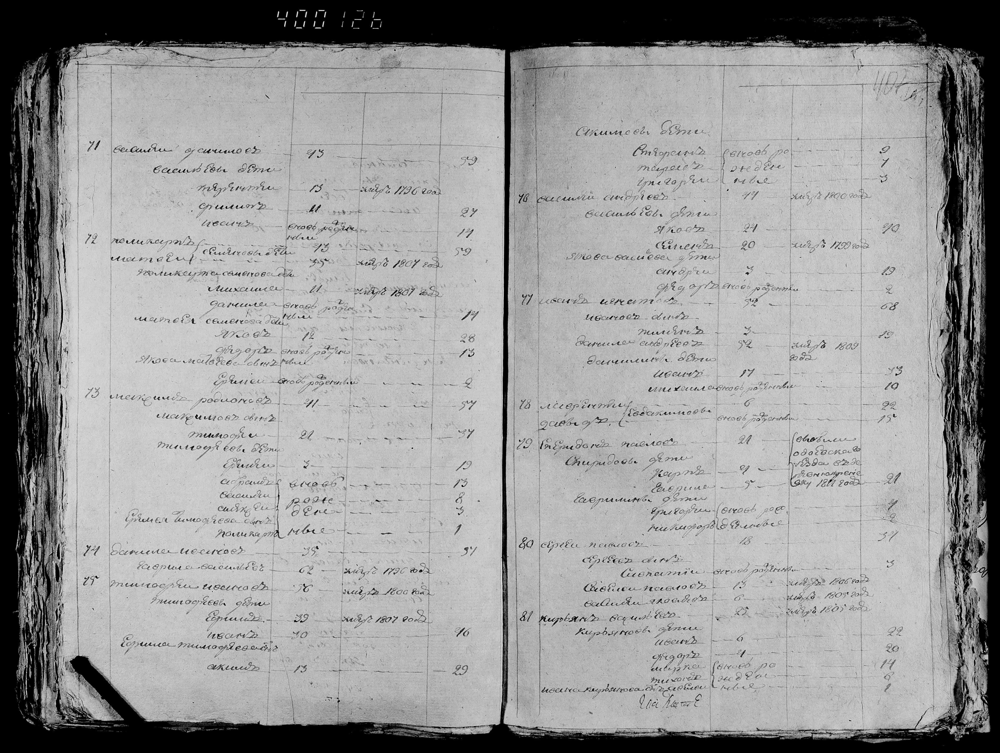

# Ревизская сказка 1811 года, село Левинское: семьи № 7 и 78

Образы 120, 121 и 129 в DGS 7563666 на FamilySearch:
https://www.familysearch.org/search/film/007563666?i=119. 6-я ревизия, № 501,
«подана 30 сентября 1811 года»: «1811 года сентября 30 дня Тульской губернии
Одоевского уезда Дряпловской волости села Левинского однодворцов о
состоящих мужеского пола душах» (образ 120); ГАТО (Тула), ф. 343, оп. 1,
д. 3. Лета — по ревизии 1795 года и в 1811 году; женщин в сказке нет.
Расшифровка сделана с помощью ИИ (Claude) и сверена с образами.

## Семья № 7 (образ 121, правая страница вверху)

| Запись | 1795 | Выбыл | 1811 |
|---|---|---|---|
| «Иван Гаврилов» | 67 | «умер 1800 года» | |
| «Иванов сын Евдоким» | 34 | «умер 1801 года» | |
| «Евдокимов сын Алексей» | 14 | — | 30 |
| «Алексеев сын устинъ» | вновь рожденный | — | 1 |

## Семья № 78 (образ 129, правая страница)

| Запись | 1795 | Выбыл | 1811 |
|---|---|---|---|
| «Мелентий» } «Евдокимовы» | 6 | — | 22 |
| «Давыд» } | вновь рожденный | — | 15 |
