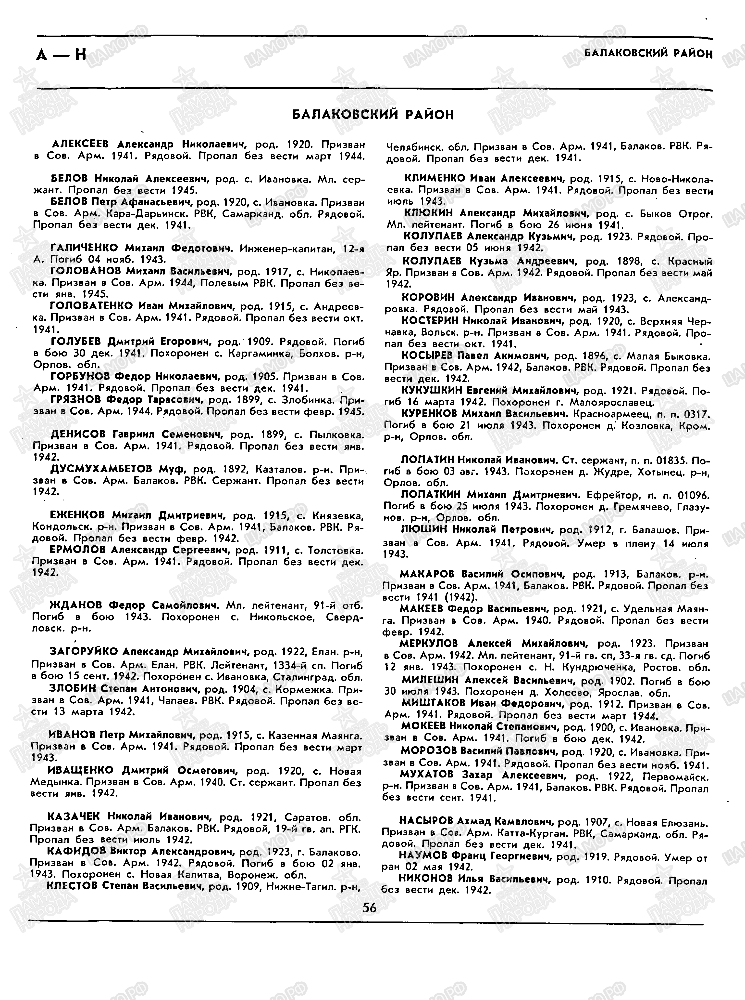

https://pamyat-naroda.ru/heroes/memorial-chelovek_pechatnoi_knigi_pamyati406835906

КОСЫРЕВ Павел Акимович\
Печатная Книга Памяти\
Дата рождения: __.__.1896\
Место рождения: с. Малая Выковка\
Дата и место призыва: Балаков. РВК\
Дата выбытия: __.12.1942\
Источник информации: Книга памяти. Саратовская область. Том 10
