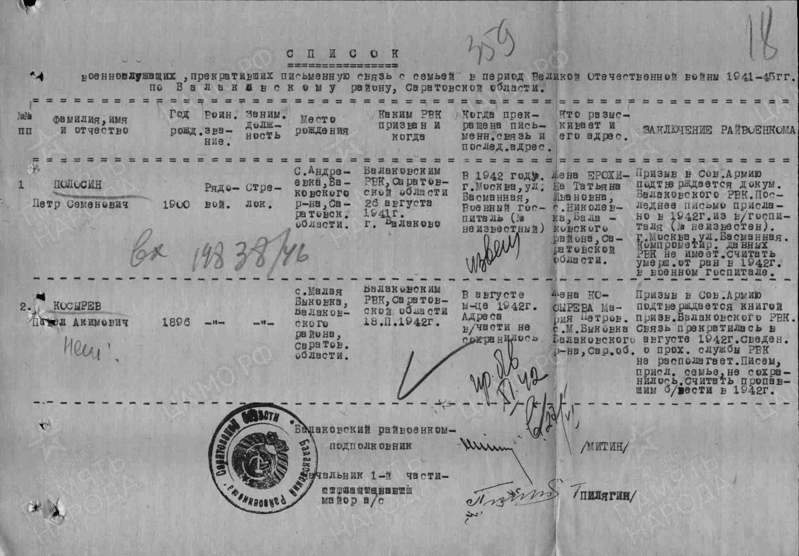

https://pamyat-naroda.ru/heroes/memorial-chelovek_dopolnitelnoe_donesenie70285898/

Косырев Павел Акимович\
Документ, уточняющий потери\
Дата рождения: __.__.1896\
Наименование военкомата: Балаковский РВК, Саратовская обл., Балаковский р-н\
Дата и место призыва: Балаковский РВК, Саратовская обл., Балаковский р-н\
Дата призыва: 18.02.1942\
Воинское звание: рядовой\
Дата выбытия: __.11.1942\
Причина выбытия: пропал без вести\
Место призыва: Балаковский РВК, Саратовская обл., Балаковский р-н\
Источник информации: ЦАМО\
Фонд ист. информации: 58\
Опись ист. информации: 977525\
Дело ист. информации: 124
