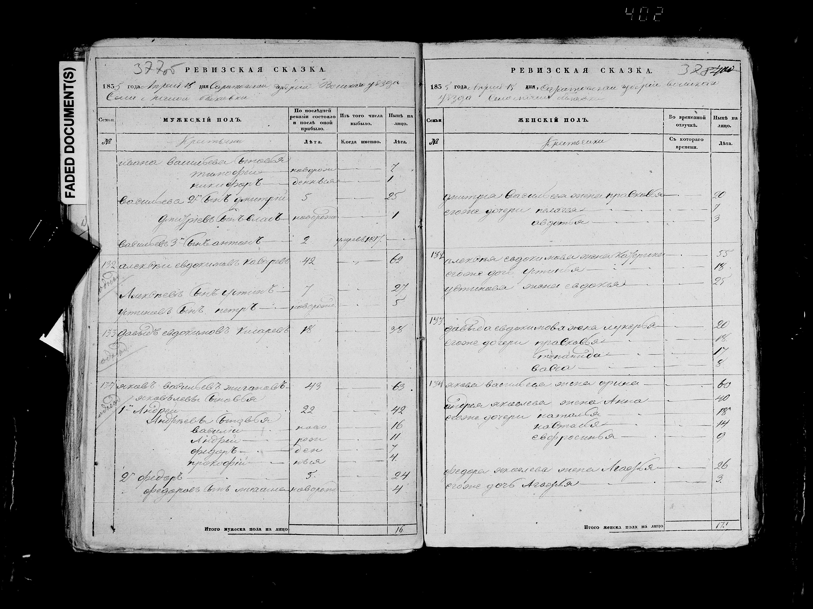
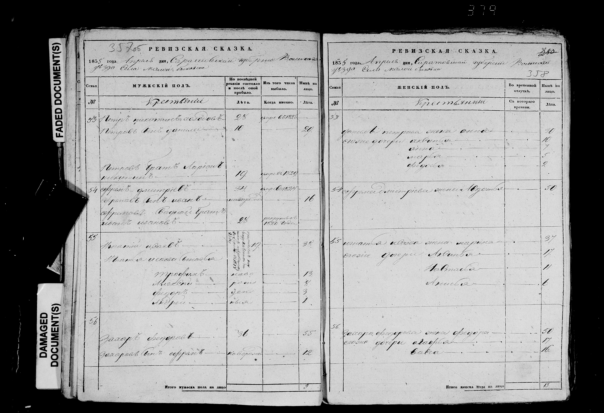
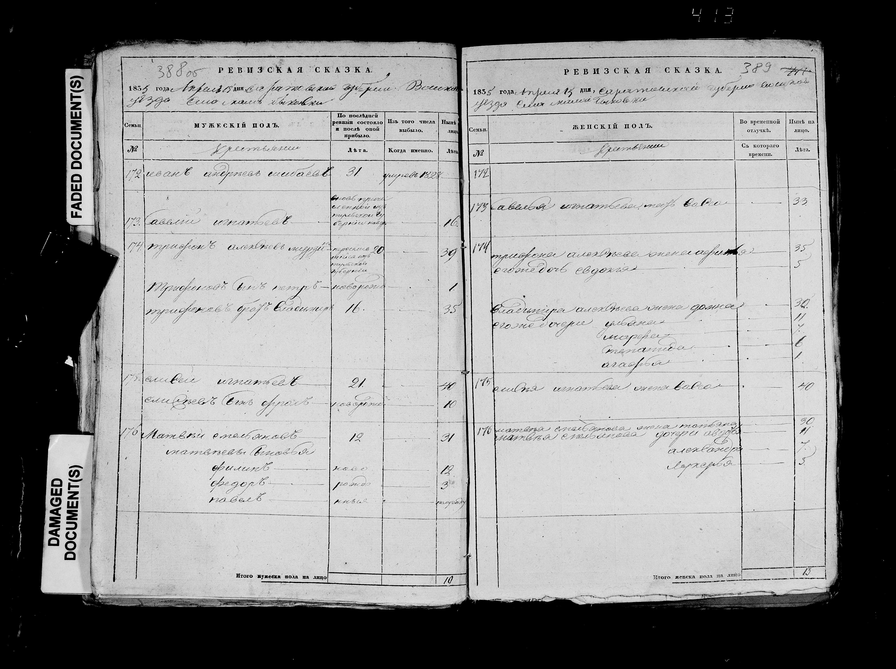

# Ревизская сказка 1835 года, село Малая Быковка

Образ 406 в DGS 7821386 на FamilySearch (номер кадра на самом образе —
402). Страницу указала участница форума ВГД Cdtnf 20 ноября 2026 года.
Расшифровка сделана с помощью ИИ (Claude) и может содержать ошибки; возраст
особенно стоит сверить с образом.

- Заголовок (на обеих страницах): «1835 года Апреля 15 дня, Саратовской
  губернии Вольского уезда село Малая Быковка».
- Листы: 377 об. (слева), 378 (справа; «400» зачёркнуто). Кадр 402
  (образ 406 в DGS 7821386).
- Шифр на образе не указан. ЦГАСО (Самара), ф. 150, оп. 1, д. 60 — по
  записи каталога FamilySearch «Ревизские сказки, Волгск (уезд) 1835»,
  плёнка 2360931, item 1, DGS 7821386:
  https://www.familysearch.org/en/search/catalog/1328882?availability=Family%20History%20Library
  (указана Cdtnf; сама она назвала «Ф 153 оп1 д.60» — вероятно, описка).

Расшифровка всего списка села, семьи № 1–178 (черновик):
[transcription.md](transcription.md).

## Семья № 132

| Пол | Запись | Лета по последней ревизии (1816) | Из того числа выбыло | Ныне на лицо (1835) |
|---|---|---|---|---|
| М | «Алексей Евдокимов Кас…ревъ» | 42 | — | 62 |
| М | «Алексеев сын Устин» | 7 | — | 27 |
| М | «Устинов сын Петр» | новорожденный | — | 5 |
| Ж | «Алексея Евдокимова жена Катерина» | | | 55 |
| Ж | «его же дочь Устинья» | | | 18 |
| Ж | «Устинова жена Евдокия» | | | 25 |

## Соседние семьи на той же странице

Прочтения менее уверенные:

- № 132, фамилия написана неразборчиво: «Ка», затем буква, которую писарь
  пишет так же, как «с» в «сынъ», затем неясная — «а» или «ы» — и «ревъ»:
  «Кас…ревъ» (раньше прочитано «Косаревъ», потом «Касыревъ»). В ревизской
  сказке 1850 года, которая продолжает эту, — ясно «Косаревъ».
- № 133: «Давыд Евдокимов Ки…аревъ», возможно «Киларевъ», 18 → 38; на
  женской стороне — его жена Лукерья (20) и дочери Прасковья (18),
  Степанида (17) и Васса (8). «евдокимовъ» в обеих записях написано почти
  одинаково, но фамилии разные. В ревизской сказке 1850 года обе фамилии
  написаны ясно — «Косаревъ» ([../revision-1850/](../revision-1850/)).
- № 134: «Яков Васильев Жиганов», 43 → 63.
- У всех трёх семей на поле другой рукой пометка «однод.» (однодворец).

## Откуда причислены семьи № 55, 173 и 174

Приписки в графе «По последней ревизии состояло и после оной прибыло»,
прочитанные по образам (Claude, 23 ноября 2026 года).

Образ 383 в DGS 7821386 (кадр 379), л. 357 об. – 358, семьи № 53–56.
Семья № 55, «Игнатий Исаев», 19 и 38 лет: «причисленъ по указу Казенной
палаты изъ рязанской губерніи въ 1818 году» (вертикально, в графе 1816).

Образ 417 в DGS 7821386 (кадр 413), л. 388 об. – 389, семьи № 172–176.
Семья № 173, «Савелий Игнатьев», 16 лет: «вновь причисленной изъ т…ской
губерніи новорожд.» — вероятно, «тульской», как у следующей семьи, но буквы
перед «ской» неясны. Семья № 174, «Трифон Алексеев Жердин(?)», 20 и 39 лет:
«переселившейся изъ тульской губерніи».
