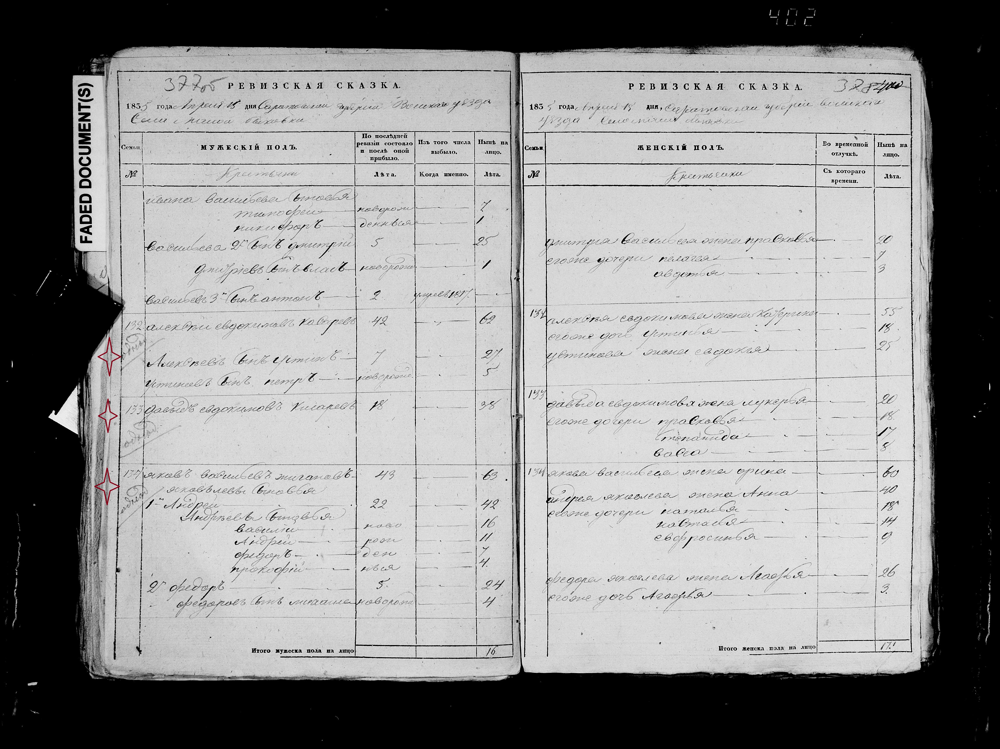

# Ревизская сказка 1835 года, село Малая Быковка

Прислана участницей форума ВГД Cdtnf 20 ноября 2026 года. Расшифровка
сделана с помощью ИИ (Claude) и может содержать ошибки; возраст особенно
стоит сверить с образом.

- Заголовок (на обеих страницах): «1835 года Апреля 15 дня, Саратовской
  губернии Вольского уезда село Малая Быковка».
- Листы: 377 об. (слева), 378 (справа; «400» зачёркнуто). Кадр 402.
- Шифр архивного дела на образе не указан; по сообщению Cdtnf —
  ф. 153, оп. 1, д. 60 (архив не назван).
- Семьи № 132, 133 и 134 отмечены Cdtnf красными звёздочками.

## Семья № 132

| Пол | Запись | Лета по последней ревизии (1816) | Из того числа выбыло | Ныне на лицо (1835) |
|---|---|---|---|---|
| М | «Алексей Евдокимов Косарев» | 42 | — | 62 |
| М | «Алексеев сын Устин» | 7 | — | 27 |
| М | «Устинов сын Петр» | новорожденный | — | 5 |
| Ж | «Алексея Евдокимова жена Катерина» | | | 55 |
| Ж | «его же дочь Устинья» | | | 18 |
| Ж | «Устинова жена Евдокия» | | | 25 |

## Соседние семьи на той же странице

Прочтения менее уверенные:

- № 133: «Давыд Евдокимов», 18 → 38; на женской стороне — его жена
  Лукерья (20) и дочери Прасковья (18), Степанида (17) и Васса (8).
  Фамилия читается с трудом, но похожа на фамилию Алексея: явно начинается
  на «К» и кончается на «-аревъ»; две средние буквы неясны. «евдокимовъ» в
  обеих записях написано почти одинаково.
- № 132, фамилия при ближайшем рассмотрении: «Ка» + неясная буква +
  «ыревъ» или «аревъ»; возможно, «Касыревъ», а не «Косаревъ».
- № 134: «Яков Васильев Жиганов», 43 → 63.
