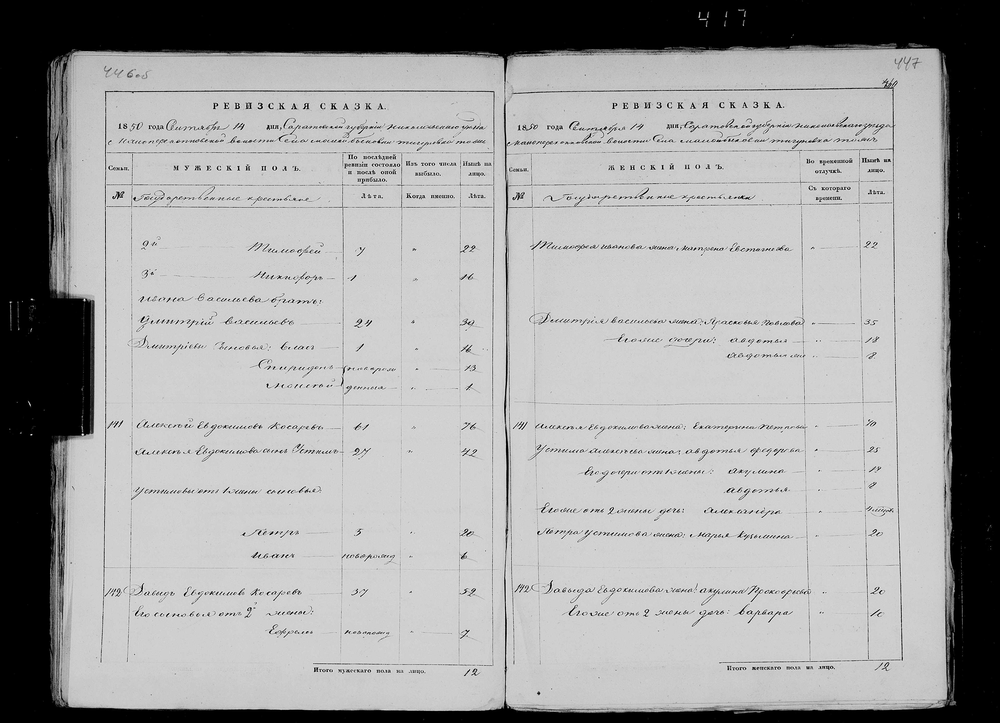
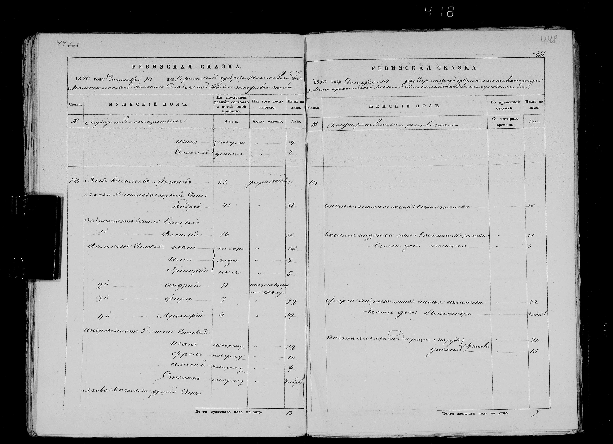

# Ревизская сказка 1850 года, село Малая Быковка

Образы 419 и 420 в DGS 7821897 на FamilySearch (номера кадров на самих
образах — 417 и 418). Расшифровка сделана с помощью ИИ (Claude) и сверена
с образами; возраст особенно стоит сверить с образом.

- Заголовок (на всех страницах): «1850 года Сентября 14 дня, Саратовской
  губернии Николаевского уезда Малоперекопновской волости Села Малой
  Быковки, Тигуновка тож». Сказка № 55.
- Листы: 446 об. – 447 (образ 419), 447 об. – 448 (образ 420).
- ЦГАСО (Самара), ф. 150, оп. 1, д. 96 (продолжение) — по записи каталога
  FamilySearch «Ревизские сказки, Николаевск (уезд) 1850-1858», плёнка
  2362209, item 1, DGS 7821897:
  https://www.familysearch.org/en/search/catalog/koha:1329593

Расшифровка всего списка села, семьи № 1–181 (черновик):
[transcription.md](transcription.md).

## Семья № 141

| Пол | Запись | Лета по последней ревизии (1835) | Из того числа выбыло | Ныне на лицо (1850) |
|---|---|---|---|---|
| М | «Алексей Евдокимов Косарев» | 61 | — | 76 |
| М | «Алексея Евдокимова сын Устин» | 27 | — | 42 |
| М | «Устиновы от 1 жены сыновья: Петр» | 5 | — | 20 |
| М | «Иван» | новорожденный | — | 6 |
| Ж | «Алексея Евдокимова жена Екатерина Петрова» | | | 70 |
| Ж | «Устина Алексеева жена Авдотья Федорова» | | | 25 |
| Ж | «Его дочери от 1 жены: Акулина» | | | 18(?) |
| Ж | «Авдотья» | | | 8 |
| Ж | «Его же от 2 жены дочь Александра» | | | 4 месяцев |
| Ж | «Петра Устинова жена Марья Кузьмина» | | | 20 |

## Семья № 142

| Пол | Запись | Лета по последней ревизии (1835) | Из того числа выбыло | Ныне на лицо (1850) |
|---|---|---|---|---|
| М | «Давыд Евдокимов Косарев» | 37 | — | 52 |
| М | «Его сыновья от 2 жены: Ефрем» | новорожденный | — | 7 |
| М | «Иван» (образ 420) | новорожденный | — | 4 |
| М | «Ермолай» (образ 420) | новорожденный | — | 2 |
| Ж | «Давыда Евдокимова жена Акулина Прокофьева» | | | 20 |
| Ж | «Его же от 2 жены дочь Варвара» | | | 10 |

## Соседние семьи

- № 140 (образ 419, начало на образе 418): «Иван Васильев Дворянчиков»
  с сыновьями и братом Дмитрием Васильевым.
- № 143 (образ 420): «Яков Васильев Жиганов», 62, «умер в 1841 году»; его
  сын Андрей, 41 → 56. Жигановы — соседи Косаревых и в 1835 году (№ 134).
- Фамилия в обеих семьях написана ясно: «Косаревъ». В 1835 году она
  прочитана у № 132 как «Касыревъ(?)», у № 133 — как «Ки…аревъ».
