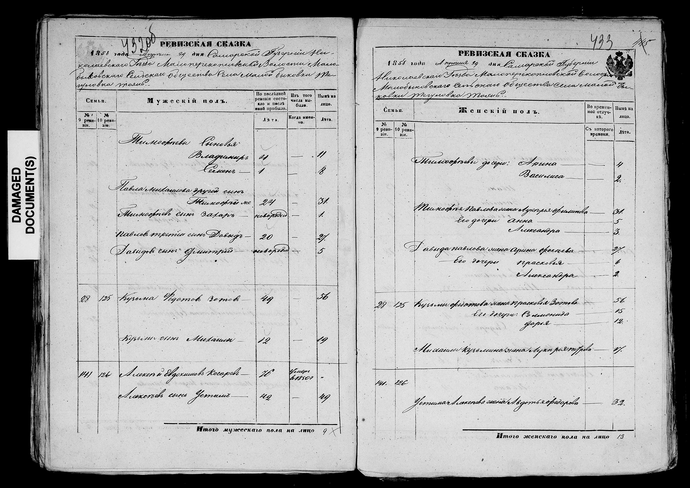
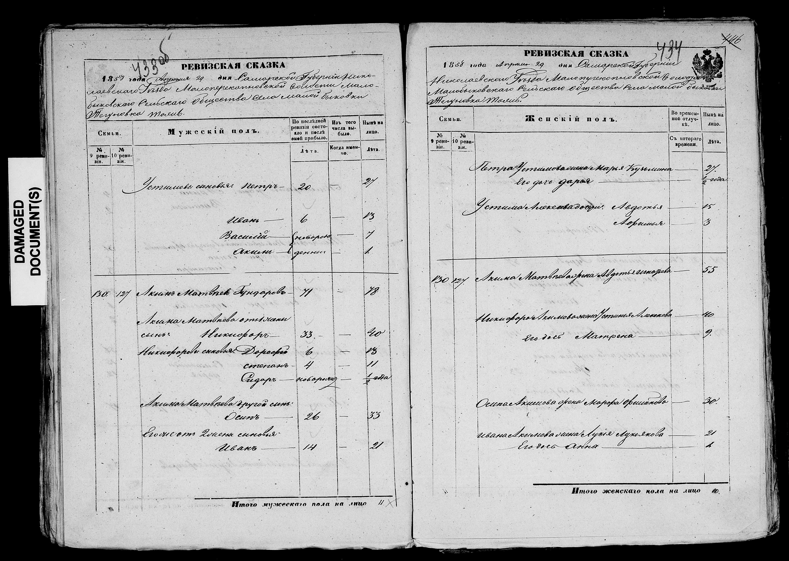
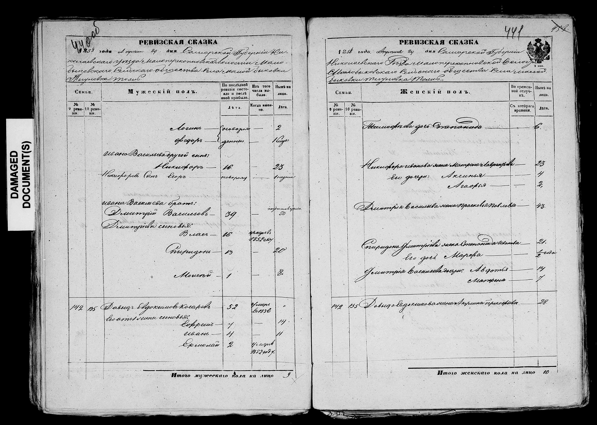

# Ревизская сказка 1858 года, село Малая Быковка

Образы 428, 429 и 436 в DGS 7820668 на FamilySearch. Расшифровка сделана с
помощью ИИ (Claude) и сверена с образами; возраст особенно стоит сверить с
образом.

- Заголовок (на всех страницах): «1858 года Апреля 29 дня, Самарской
  Губернии Николаевского Уезда Малоперекопновской Волости Малобыковского
  Сельского общества Села Малой быковки Тегуновка тож».
- Листы: 432 об. – 433 (образ 428), 433 об. – 434 (образ 429), 440 об. –
  441 (образ 436).
- ЦГАСО (Самара), ф. 150, оп. 1, д. 157 (продолжение) — по записи каталога
  FamilySearch «Ревизские сказки, Николаевск (уезд) 1850-1858», плёнка
  2373704, DGS 7820668:
  https://www.familysearch.org/en/search/catalog/koha:1329593
- У каждой семьи два номера: по 9-й ревизии (1850) и по 10-й (1858).

Расшифровка всего списка села (черновик): [transcription.md](transcription.md).

## Семья № 126 (по 9-й ревизии № 141), образы 428–429

| Пол | Запись | Лета по последней ревизии (1850) | Из того числа выбыло | Ныне на лицо (1858) |
|---|---|---|---|---|
| М | «Алексей Евдокимов Косаров» | 76 | умер в 1850 г. | — |
| М | «Алексеев сын Устин» | 42 | — | 49 |
| М | «Устиновы сыновья: Петр» | 20 | — | 27 |
| М | «Иван» | 6 | — | 13 |
| М | «Василий» | новорожденный | — | 7 |
| М | «Аким» | новорожденный | — | 1 |
| Ж | «Устина Алексеева жена Авдотья Федорова» | | | 32 |
| Ж | «Петра Устинова жена Марья Кузьмина» | | | 27 |
| Ж | «Его дочь Дарья» | | | ½ года |
| Ж | «Устина Алексеева дочери: Авдотья» | | | 15 |
| Ж | «Афимья(?)» | | | 3 |

## Семья № 127 (№ 130), образ 429: Гундоровы

- «Аким Матвеев Гундоров», 71 → 78; его сын «Никифор», 33 → 40, с сыновьями.
- «Никифора Акимова жена Устинья Алексеева», 40.

## Семья № 135 (№ 142), образ 436

| Пол | Запись | Лета по последней ревизии (1850) | Из того числа выбыло | Ныне на лицо (1858) |
|---|---|---|---|---|
| М | «Давыд Евдокимов Косарев» | 52 | умер в 1856 | — |
| М | «Его от 1 жены сыновья: Ефрем» | 7 | — | 14 |
| М | «Иван» | 4 | — | 11 |
| М | «Ермолай» | 2 | умер в 1852 году | — |
| Ж | «Давыда Евдокимова жена Акулина Прокофьева» | | | 28 |

В 1850 году те же сыновья записаны «от 2 жены».
