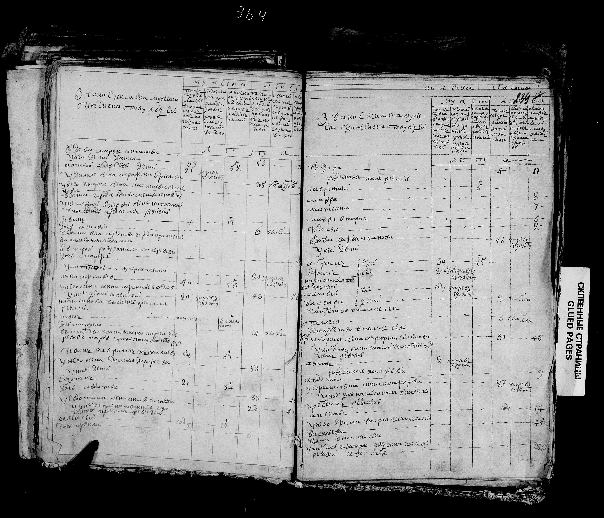

# Ревизская сказка 1795 года, село Левенское: семья Ивана Гаврилова Согалаева

Образ 363 в DGS 7563664 на FamilySearch:
https://www.familysearch.org/search/film/007563664?i=362 — листы 238 об. –
239. 5-я ревизия, № 25, однодворцы села Левенского Одоевской округи; ГАТО
(Тула), ф. 344, оп. 1, д. 7 или 8. Лета — по ревизии 1782 года и в 1795 году.
Расшифровка сделана с помощью ИИ (Claude) и сверена с образом.

| Запись | Муж. 1782 | Выбыл | Муж. 1795 | Жен. 1782 | Выбыла | Жен. 1795 |
|---|---|---|---|---|---|---|
| «Иван Гаврилов сын Согалаев» | 54 | — | 67 | | | |
| «У него жена Домна Захарьева(?)» | | | | 58 | — | 7… |
| «У них дети: Евдоким» | 21 | — | 34 | | | |
| «Дочь Авдотья» | | | | 33(?) | — | 4… |
| «У Евдокима жена Анна …» | | | | 28(?) | — | 41 |
| «У них дети написанныя в последнюю предсим ревизию: Алексей» | году | — | 14 | | | |
| «Дочь Арина» | | | | 6 | — | 1… |
| «Федора» (лист 239) | | | | 4 | — | 17 |
| «рожденныя после ревизии: Лаврентий» | | | 6 | | | |
| «Мавра» | | | | | | 8 |
| «Татьяна» | | | | | | 7 |
| «Мавра вторая» | | | | | | 6 |
| «Федосья» | | | | | | 2 |

Дальше — следующая семья, «Вдова Софья Иванова». Часть цифр у переплёта не
видна («…»).
